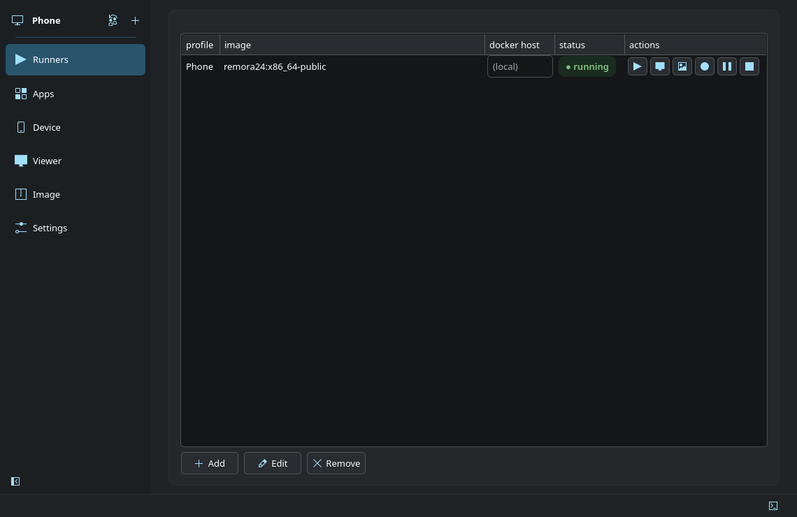
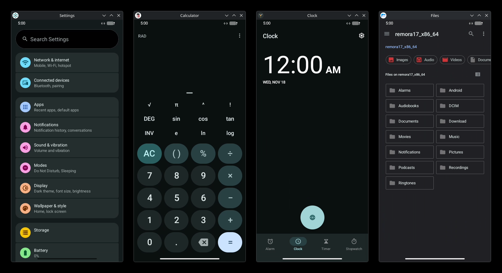
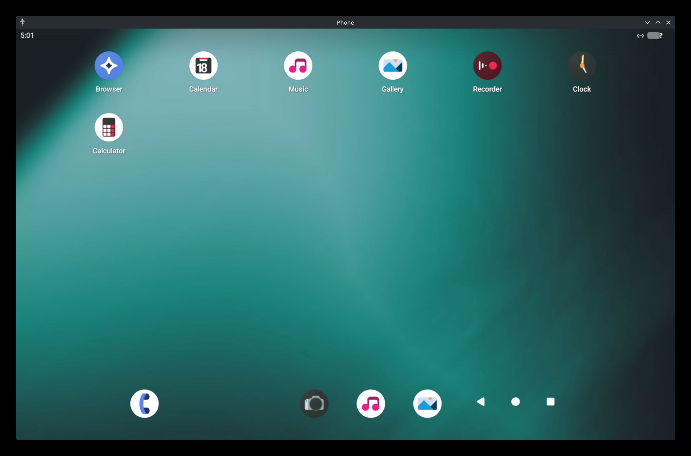
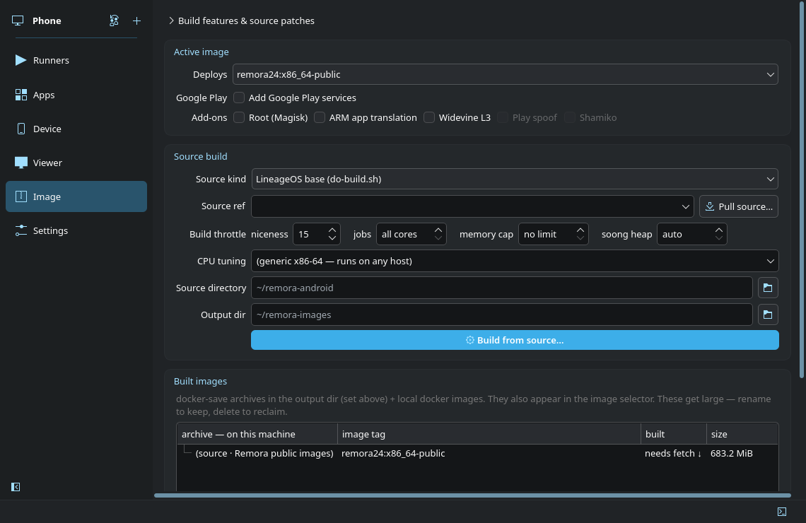
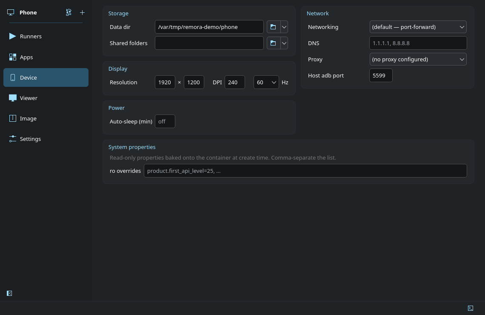
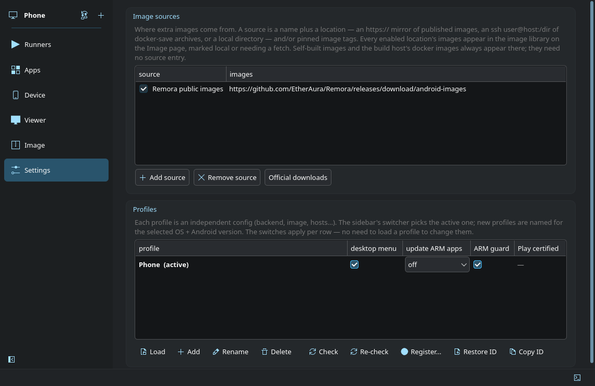

<div align="center">

<picture>
  <source media="(prefers-color-scheme: dark)" srcset="packaging/io.github.EtherAura.Remora.svg">
  
</picture>

# Remora

**Runs Android 16 or 17 (LineageOS) in Docker and opens each app in its own window.**

Android 16 / 17 · Docker · Linux x86_64 · FreeBSD 15 amd64 · Windows (preview) · GPL-3.0

[](https://github.com/EtherAura/Remora/actions/workflows/ci.yml)
[](https://github.com/EtherAura/Remora/actions/workflows/codeql.yml)
[](https://github.com/EtherAura/Remora/releases/latest)

[**Download**](https://github.com/EtherAura/Remora/releases/latest) · [**Getting started**](docs/user/Getting-Started.md) · [**User guide**](https://github.com/EtherAura/Remora/wiki)



<sub>The Remora workspace: runners</sub>

| App windows: one per Android app | Mirror window: the whole device |
|:---:|:---:|
|  |  |

| Image: pick, extend or build | Device: storage, display, network | Settings: image sources, profiles |
|:---:|:---:|:---:|
|  |  |  |

</div>

## Quick start

1. [Install Remora](docs/user/Installation.md) on Linux, FreeBSD 15 amd64, or Windows 10 or 11.
   FreeBSD connects to a Linux Docker host over SSH. [FreeBSD installation](docs/user/Installation.md#freebsd-15-amd64)
2. Fetch the ready-made Android 17 image. For a remote target, add `--host user@linux-host`.

   ```sh
   remora images fetch --tag remora24:x86_64-public
   ```

3. Run `remora check`, name the image in your profile and deploy:
   [Getting Started](docs/user/Getting-Started.md).

## At a glance

- **Image:** the ready-made Android 17 image is a 716 MB download and takes 2.4 GB in Docker. It
  has no Google apps; [Google Play](docs/user/CLI-Reference.md#optional-google-play) and
  [add-ons](docs/user/Image-Features.md#add-ons-root-arm-translation-and-widevine) are added
  locally.
- **GPU:** NVIDIA, Intel and AMD on Linux; SwiftShader without one, and on Windows
  ([GPU acceleration](docs/user/GPU-Acceleration.md)).
- **Hosts:** this machine, or any Docker host over ssh ([Deploy targets](docs/user/Deploy-Targets.md)).
- **Custom builds:** build LineageOS from source with the features you pick, in about 450 GB of
  disk and 32 GB of RAM ([Building the image](docs/user/Building-the-Image.md)).

[Requirements](docs/user/Requirements.md) · [Feature overview](docs/Overview.md) · [Troubleshooting](docs/user/Troubleshooting.md) · [Contributing](CONTRIBUTING.md) · [Security](SECURITY.md) · [Discussions](https://github.com/EtherAura/Remora/discussions)

Remora is free and open source. Support it on [Patreon](https://www.patreon.com/EtherAura);
patrons vote on what gets built next at [requests.agartha.digital](https://requests.agartha.digital/).
