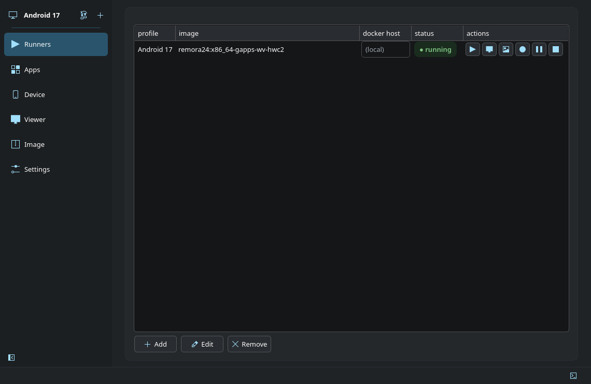

# Remora

**Android apps, at home on your Linux desktop.**

Build Android 16 or 17 from source, deploy it in Docker, and open each app in its own window.

[**Get started**](docs/user/Getting-Started.md) · [**Requirements**](docs/user/Requirements.md) · [**User guide**](https://github.com/EtherAura/Remora/wiki) · [**Downloads**](https://github.com/EtherAura/Remora/releases)

| Compose | Deploy | Connect |
|---|---|---|
| [Choose image features](docs/user/Image-Features.md) | [Local or remote Docker](docs/user/Deploy-Targets.md) | [Mirroring and desktop apps](docs/user/Android-Apps-on-the-Desktop.md) |

NVIDIA, Intel and AMD [GPU acceleration](docs/user/GPU-Acceleration.md), with a shared Qt workspace and CLI.

## Before you start

**You build your own Android image.** Allow about **450 GB free disk** and **32 GB RAM** (64 GB recommended) for the first build.
Start with [requirements](docs/user/Requirements.md), [installation](docs/user/Installation.md) and [building the image](docs/user/Building-the-Image.md).

[Full feature overview](docs/Overview.md) · [Configuration](docs/user/Configuration.md) · [Troubleshooting](docs/user/Troubleshooting.md) · [Contributing](CONTRIBUTING.md) · [Security](SECURITY.md) · [Discussions](https://github.com/EtherAura/Remora/discussions)
